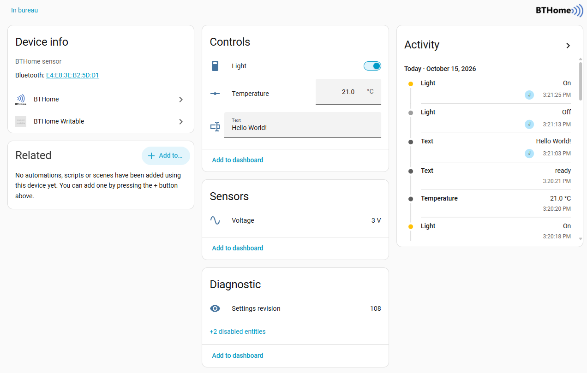

<!--- Copyright (c) 2026 Jean-Philippe Rey. See the file LICENSE for copying permission. -->
BTHome Light Switch for Home Assistant
======================================

<span style="color:red">:warning: **Please view the correctly rendered version of this page at https://www.espruino.com/BTHome+Light+Switch. Links, lists, videos, search, and other features will not work correctly when viewed on GitHub** :warning:</span>

* KEYWORDS: Tutorials,BTHome,BTHomeWritable,HomeAssistant,Home Assistant,Writable,Switch,Light
* USES: Puck.js,MDBT42Q,Bangle.js,BLE,BTHome

[BTHome](/BTHome) tells [Home Assistant](https://www.home-assistant.io/) what
your device has measured. This goes the other way: **Home Assistant switches the
LED on your Puck.js**, from the same device page its sensors are already on, and
the board needs about twenty lines for it.

It uses the [BTHomeWritable](/BTHomeWritable) module. Your device advertises
BTHome exactly as before and adds one object saying which entries it accepts
writes for. A receiver connects briefly, writes **one BTHome object** to that
entry's own GATT characteristic, and disconnects.

You'll need
-----------

* an nRF52 Espruino board — [Puck.js](/Puck.js), [MDBT42Q](/MDBT42Q),
  [Bangle.js 2](/Bangle.js2)
* Home Assistant with Bluetooth working, set up as in
  [BTHome and Home Assistant Setup](/BTHome+Setup)
* the [bthome-writable](https://github.com/yerpj/bthome-writable) integration,
  installed through [HACS](https://hacs.xyz/). It is needed because **the
  declaration uses an object id BTHome has not assigned yet**: core BTHome goes
  on reading your sensors and ignores the rest, so adding this to a device
  breaks nothing that already works.

The code
--------

```JS
var bw = require("BTHomeWritable");

var light = { on: false };

function apply() {
  digitalWrite(LED1, light.on); // swap LED1 for a relay pin
}

bw.setup({
  advertise: [
    { type: "battery", get: function () { return E.getBattery(); } },
    // `set` is what makes an entry writable. Its state is never advertised --
    // nothing but a write changes it, so it needs no `get` here.
    { type: "light", set: function (v) { light.on = v; apply(); } }
  ],
  interval: 1000,
  // Espruino acknowledges a write before your handler runs, so a write this
  // device rejects still looks delivered to the receiver. This is the only
  // place it shows.
  onError: function (e) { console.log("write rejected:", e.code, e.message); }
});

apply();
console.log("advertising as", NRF.getAddress());
console.log("writable entries:", bw.plan().entryIds);
```

Send it with the Web IDE and it prints `writable entries: [ 30 ]` — 30 is
`0x1E`, BTHome's `light` object, and it is what Home Assistant will write to.

Keep it in RAM while you are experimenting rather than saving it: an advertising
payload the radio refuses leaves a device that cannot be connected to, and from
`.bootcde` that repeats at every boot.

In Home Assistant
-----------------

The device turns up under `Settings -> Devices & Services` the way any BTHome
device does. Its page gains a **Controls** card with a toggle beside the battery
reading it already had.

Flip the toggle and the LED follows. The write itself is **36 ms** on a Puck.js;
what you actually wait for is the connection — about **half a second** when you
have just used the device, and **one to five seconds** when it has been idle,
because a central can only start a connection when it catches an advertising
event and the device advertises slowly when nothing is happening.
`fastInterval` and `fastTimeout` are where you trade battery for that.

More than a switch
------------------

Entries are BTHome objects, so a `set` on another type gives you another kind of
control: a `temperature` entry becomes a number box, a `text` entry a text
field.



Give an entry a `get` as well **when something other than a receiver can change
it** — a button, a schedule, your own code — and call `bw.changed()` when that
happens, so receivers read it again:

```JS
{ type: "temperature", get: function () { return state.target; },
                       set: function (v) { state.target = v; } },
{ type: "text",        get: function () { return state.text; },
                       set: function (v) { state.text = v; } }
```

Those four objects and the declaration come to 13 bytes of service data. If the
radio refuses the packet, `showName: false` is the cheapest thing to drop: a
receiver finds the device by its BTHome service data anyway.

Things worth knowing
--------------------

* **One central at a time.** These boards serve a single connection, so a write
  will fail while the Web IDE is connected to the board.
* **Encryption is one option.** Give `setup()` a `bindkey` and the advertising,
  the writes and the reads are all sealed with AES-CCM. That needs the
  [AESCCM](/AESCCM) module, and [BTHomeWritable](/BTHomeWritable) has the
  details.
* **This is a proposal.** The declaration's object id `0xFF` is
  [proposed to BTHome](https://github.com/home-assistant/bthome.io/pull/82) and
  has not been assigned. If a different one is assigned, the module changes a
  constant and receivers change with it.
